<picture><source media="(prefers-color-scheme: dark)" srcset="assets/hero-dark.svg"></picture>

Student from Czechia who ships things people actually use. Most of it is Python and Flask, plus a bit of Java, JavaScript and three.js whenever an idea needs it. Two laser-game arenas run their bookings on my code, my school parliament votes in my app, and my friends fight with my plugin's weapons.

[Portfolio](https://voku199.github.io/Portfolio/) · [Bakix](https://bakix.cz) · [Email](mailto:vojta.kurinec@gmail.com)

 

<picture><source media="(prefers-color-scheme: dark)" srcset="assets/stats-dark.svg"></picture>

  

<picture><source media="(prefers-color-scheme: dark)" srcset="assets/h1-dark.svg"></picture>

<picture><source media="(prefers-color-scheme: dark)" srcset="assets/card0-dark.svg"></picture>
<a href="https://bakix.cz"><picture><source media="(prefers-color-scheme: dark)" srcset="assets/card1-dark.svg"></picture></a>
<picture><source media="(prefers-color-scheme: dark)" srcset="assets/card2-dark.svg"></picture>
<picture><source media="(prefers-color-scheme: dark)" srcset="assets/card3-dark.svg"></picture>
<picture><source media="(prefers-color-scheme: dark)" srcset="assets/card4-dark.svg"></picture>
<picture><source media="(prefers-color-scheme: dark)" srcset="assets/card5-dark.svg"></picture>

 

<picture><source media="(prefers-color-scheme: dark)" srcset="assets/h2-dark.svg"></picture>

- Built the booking + stats site for a **real laser-game arena** in České Budějovice and a second one for STARDOMS Domažlice (replacing their WordPress).
- Shipped **Bakix**, an AI study assistant on top of Bakaláři with OAuth and Stripe Premium, at a vibe-coding hackathon (19 May 2026).
- Wrote **LID**, the app my school parliament uses for ideas and secret ballots.
- Made a **WebXR laser-game** for the Quest 3 where you move by walking on the spot.

 

<picture><source media="(prefers-color-scheme: dark)" srcset="assets/h3-dark.svg"></picture>

Most of my projects live in a private monorepo. The finished, public ones are on my **[portfolio](https://voku199.github.io/Portfolio/)**.

 

<picture><source media="(prefers-color-scheme: dark)" srcset="assets/footer-dark.svg"></picture>
